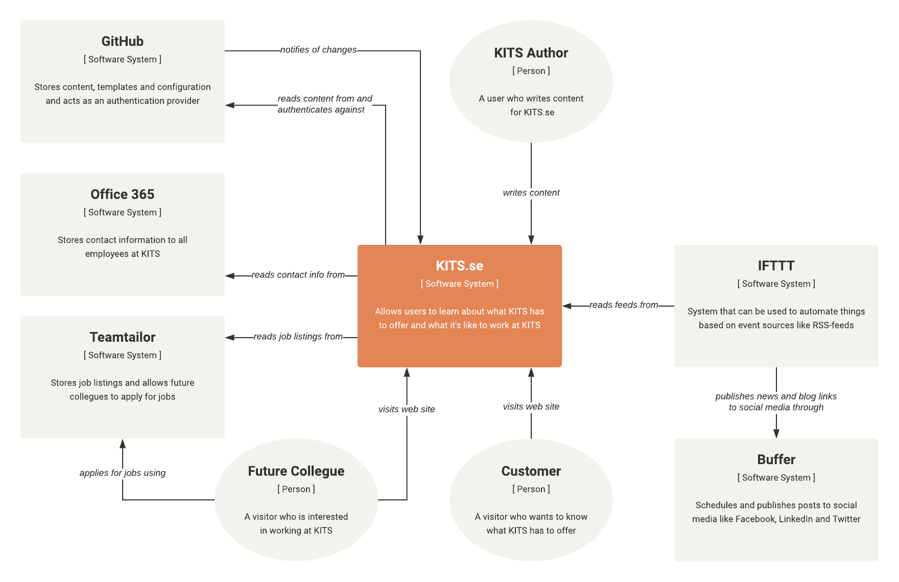
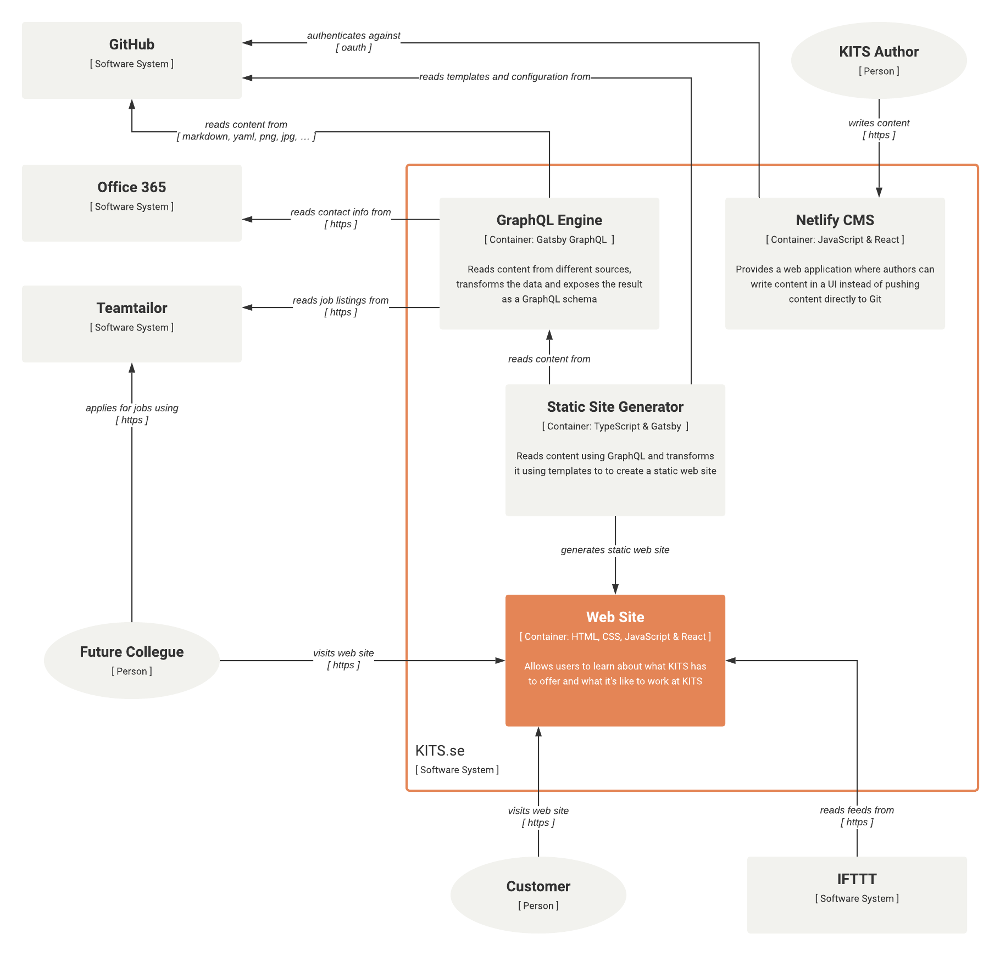

# KITS.se

Det här projektet innehåller källkoden och innehållet för <https://kits.se>.

## Översikt

Sajten byggs med den statiska sajtgeneratorn [Gatsby](https://www.gatsbyjs.org).

Systemkontextdiagrammet nedan ger en översikt över hur de olika systemen samverkar för att skapa
kits.se:

#### Systemkontextdiagram



Det är en hel del system inblandade för en så enkel sajt, men i containerdiagrammet för kits.se är
det lättare att se hur varje system används för att generera den färdiga sajten.

#### Containerdiagram



#### Arkitekturbeslut

Beslut om kod och arkitektur loggas som ADR:er i [docs/adr](docs/adr/README.md). Ett nytt beslut
ersätter ett gammalt i stället för att det gamla skrivs om.

## Lägga till innehåll

Det enklaste sättet att lägga till innehåll är att använda <https://kits.se/admin>. Du loggar in med
ditt GitHub-konto om du är medlem i KITS organisation. CMS:et är [Decap CMS](https://decapcms.org),
och varje typ av innehåll redigeras i ett eget formulär.

När du lägger till innehåll sparas det i en ny branch på GitHub och en pull request skapas. Du kan
alltså prova dig fram utan att publicera ändringarna.

### Bilder

Standardstorleken för bilder är 1800×1000. Gatsby skapar bilder i olika storlekar utifrån den högre
upplösningen, så det är viktigt att du håller dig till den storleken.

Alla bilder ska ligga i `static/assets`. Några sidor hämtar sina bilder via GraphQL och tar bara med
filer med rätt prefix och filtyp. Är namnet eller filtypen fel utelämnas bilden utan felmeddelande:

- Karriär, förmåner: `formaner_` (JPEG)
- Karriär, personas: `persona_` (PNG)
- Karriär, Cyber Academy: `cyberacademy_` (JPEG eller PNG)
- KITS Studio: `kitsstudio_` (JPEG eller PNG)
- KitsCon-kollage: `kitscon_collage_` (JPEG eller PNG)
- Avatarer: `medarbetare_fornamnefternamn-avatar.jpg` (JPEG)

Övriga bilder refereras direkt med sökväg men följer samma namngivning: `nyheter_` för nyheter,
`blogg_` för blogginlägg, `kitscon_` för KitsCon-logotyper och `medarbetare_fornamnefternamn.jpg`
för porträtt av medarbetare.

För nyheter, blogginlägg och KitsCon-föredrag visas en liten avatar bredvid skribenten eller
talaren. Avataren ska vara 350×350 och ansiktet lika stort som i de andra. Det finns en
Photoshop-mall under `resources` som kan användas.

## Utveckling

Du kan använda vilken editor du vill (Visual Studio Code, WebStorm, IntelliJ, Vim, ...), men se till
att den har stöd för följande:

- [TypeScript](https://www.typescriptlang.org): projektet är skrivet i TypeScript.
- [EditorConfig](https://editorconfig.org): hjälper editorn att använda rätt teckenkodning,
  indentering och så vidare.
- [Styled Components](https://www.styled-components.com): används för att styla komponenterna.
- [Prettier](https://prettier.io): formaterar koden enligt projektets kodkonventioner.

**Koden formateras automatiskt när du committar. Den lintas också innan du pushar.**

För felsökning bör du installera [React Developer Tools](https://github.com/facebook/react-devtools).

### Förberedelser

- Hämta koden
  ```
  $ git clone git@github.com:kits-ab/kits.git
  ```
- Installera Node enligt `.nvmrc` eller `.tool-versions` (22.21.1 när detta skrivs)

  ```
  $ nvm install
  $ nvm use
  ```

  eller

  ```
  $ asdf install
  ```

- Installera beroenden
  ```
  $ npm install
  ```

### Skript

När koden och alla beroenden är hämtade vill du förmodligen köra `npm start`, men du kan köra
vilket som helst av följande skript:

- `npm run build`: skapar ett produktionsbygge i `public/`.
- `npm run clean`: tar bort alla genererade filer.
- `npm run format`: formaterar hela kodbasen med [Prettier](https://prettier.io).
- `npm run lint`: lintar all kod med [ESLint](https://eslint.org) och
  [Stylelint](https://stylelint.io).
- `npm start`: startar en lokal server med hot reloading på <http://localhost:8000>.
- `npm test`: kör linters och typkontrollerar koden med `tsc` (körs också före varje push).

### GraphQL

Allt innehåll som läses från Markdown-, YAML- och bildfiler exponeras via GraphQL. Du kan utforska
innehållet genom att köra `npm start` och gå till <http://localhost:8000/___graphql>.

### Licens

Copyright 2015-2026 KITS AB

Licensed under the Apache License, Version 2.0 (the "License"); you may not use this work except in compliance with the License. You may obtain a copy of the License in the LICENSE file, or at:

<http://www.apache.org/licenses/LICENSE-2.0>

Unless required by applicable law or agreed to in writing, software distributed under the License is distributed on an "AS IS" BASIS, WITHOUT WARRANTIES OR CONDITIONS OF ANY KIND, either express or implied. See the License for the specific language governing permissions and limitations under the License.
